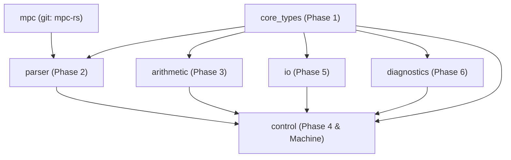

# `speedcoding` Documentation

Rust library implementation of the **1953 IBM 701 Speedcoding System (SpeedCo I)**, built with [`mpc-rs`](https://github.com/Mr-Kumar-Abhishek/mpc-rs) for parser combinators and organized around a 6-phase Red-Green-Refactor TDD roadmap.

- **Repository:** <https://github.com/Mr-Kumar-Abhishek/speedcoding>
- **Crate Version:** `0.1.0` (`edition = "2024"`)
- **Primary Reference Manual:** *IBM 701 Speedcoding System* (IBM Scientific Computing Service, 1953), archived in `102632810-05-01-acc.pdf` (Computer History Museum Catalog ID `102632810`).

---

## Documentation Index

| Document | Description |
|---|---|
| [TIMELINE-AND-BRANCHES.md](TIMELINE-AND-BRANCHES.md) | Gitflow + 6-phase branch topology, TDD workflow, milestone schedule, and Definition of Done |
| [TDD-TEST-SPECIFICATION.md](TDD-TEST-SPECIFICATION.md) | Complete specification of all 66 Red-phase TDD test cases across `src/lib.rs` and `tests/phase_1..6` |
| [ARCHITECTURE-AND-SPEC.md](ARCHITECTURE-AND-SPEC.md) | Technical reference distilled from the 1953 SpeedCo I manual: 72-bit layouts, opcodes, cards, I/O, checking, listing, and timing |

---

## Crate Module Map

| Module | File | Phase | Responsibility |
|---|---|---|---|
| `core_types` | [`src/core_types.rs`](../src/core_types.rs) | Phase 1 | `Word72`, `Address`, `SpeedFloat`, `DecimalFloat`, `RCode`, `LCode`, 49 `Op1` + 48 `Op2` opcodes, `Instruction`, `ElectrostaticMemory` |
| `parser` | [`src/parser.rs`](../src/parser.rs) | Phase 2 | `mpc`-backed mnemonic/line/program parsers and 80-column instruction, data, and loading-control card parsers |
| `arithmetic` | [`src/arithmetic.rs`](../src/arithmetic.rs) | Phase 3 | Floating-binary `OP1` arithmetic (`ADD`..`NGDIV`) and Set 1 elementary functions (`SQRT`, `SINE`, `ARTAN`, `EXP`, `LN`) |
| `control` | [`src/control.rs`](../src/control.rs) | Phase 4 | `SpeedCoMachine`, `PC` execution loop, `OP2` transfers, `RQuantities`, `AddressCounter`, location `0025` control tricks |
| `io` | [`src/io.rs`](../src/io.rs) | Phase 5 | `TapeUnit` (`J..M`) with parity/checksum/status, `DrumUnit` (`P..Q`), `LinePrinter` |
| `diagnostics` | [`src/diagnostics.rs`](../src/diagnostics.rs) | Phase 6 | `CheckingState` (`PRCH`/`STCH`/`ECHTR`), selective 10-line `ListingBuffer`, and Section 12 `TimingCalculator` |

---

## Licensing & Historical Attribution

- **Rust Crate License:** Dual-licensed under the **MIT License** ([`LICENSE-MIT`](../LICENSE-MIT)) or **Apache License, Version 2.0** ([`LICENSE-APACHE`](../LICENSE-APACHE)), declared in [`Cargo.toml`](../Cargo.toml) as `license = "MIT OR Apache-2.0"`.
- **Parser Dependency:** `mpc` (`https://github.com/Mr-Kumar-Abhishek/mpc-rs.git`, v0.1.0), licensed under the MIT License.
- **Historical Documentation Scan:** `102632810-05-01-acc.pdf` (Collection of the Computer History Museum, ID `102632810`) is included solely as historical and educational reference material, is **excluded** from Cargo crate packages (`exclude = ["102632810-05-01-acc.pdf"]`), and is governed by the Computer History Museum Terms of Use (non-commercial, personal, educational, and research fair use). See [`NOTICE`](../NOTICE) for full attribution details.
