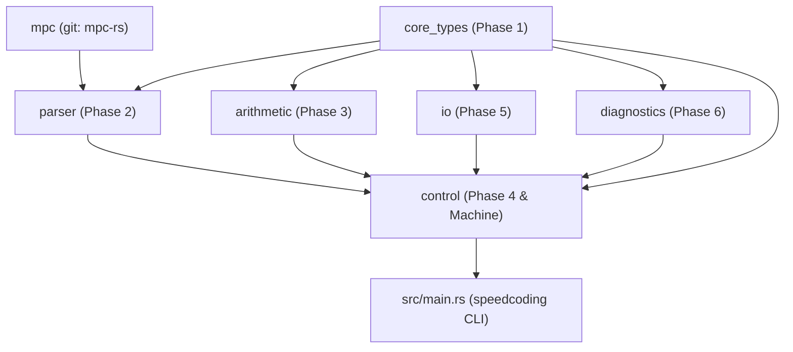

# `speedcoding` Documentation

Rust library and CLI implementation of the **1953 IBM 701 Speedcoding System (SpeedCo I)**, built with [`mpc-rs`](https://github.com/Mr-Kumar-Abhishek/mpc-rs) for parser combinators and organized around a 2-week Agile Sprint + 6-phase Red-Green-Refactor TDD roadmap.

- **Repository:** <https://github.com/Mr-Kumar-Abhishek/speedcoding>
- **GitHub Pages Portal & Rustdoc:** <https://mr-kumar-abhishek.github.io/speedcoding/>
- **GitHub Pages Reports Portal:** <https://mr-kumar-abhishek.github.io/speedcoding/report/>
- **Crate Version:** `0.1.0` (`edition = "2024"`, Sprints 0–7 stable release tag [`v0.1.0`](https://github.com/Mr-Kumar-Abhishek/speedcoding/releases/tag/v0.1.0))
- **Primary Reference Manual:** *IBM 701 Speedcoding System* (IBM Scientific Computing Service, 1953), archived in `102632810-05-01-acc.pdf` (Computer History Museum Catalog ID `102632810`).

---

## Documentation Index

| Document | Description |
|---|---|
| [index.html](index.html) | Interactive GitHub Pages documentation portal (live specs, opcode filter, Mermaid diagrams, reports, and Rustdoc entrypoint) |
| [AGILE-SPRINTS.md](AGILE-SPRINTS.md) | 2-week Agile Sprint workflow, ceremonies, Sprints 0–7 roadmap, Product Backlog (`US-01..US-15`), DoR & DoD |
| [TIMELINE-AND-BRANCHES.md](TIMELINE-AND-BRANCHES.md) | Gitflow + 6-phase branch topology, TDD workflow, milestone schedule, and release targets |
| [TDD-TEST-SPECIFICATION.md](TDD-TEST-SPECIFICATION.md) | Complete specification of all 79 verified test cases across `src/`, `tests/bench_speedcoding.rs`, `tests/phase_1..6`, and `tests/e2e_speedcoding.rs` |
| [ARCHITECTURE-AND-SPEC.md](ARCHITECTURE-AND-SPEC.md) | Technical reference distilled from the 1953 SpeedCo I manual: 72-bit layouts, opcodes, cards, I/O, checking, listing, and timing |
| [report/index.html](../report/index.html) | Standalone GitHub Pages HTML viewer for the Benchmark and `v0.1.0` Compliance reports |
| [speedcoding-benchmark-report.md](../report/speedcoding-benchmark-report.md) | Debug & Release parsing benchmark results (`tests/bench_speedcoding.rs`) |
| [compliance-report.md](../report/compliance-report.md) | License/IP, all-79-test SpeedCo I traceability register, Docker/CI/CD builds, and compliance audit |

---

## Crate Module Map & Repository Tooling



| Module / Asset | File | Sprint / Phase | Responsibility |
|---|---|---|---|
| `core_types` | [`src/core_types.rs`](../src/core_types.rs) | Sprint 1 / Phase 1 | `Word72`, `Address`, `SpeedFloat`, `DecimalFloat`, `RCode`, `LCode`, 49 `Op1` + 48 `Op2` opcodes, `Instruction`, `ElectrostaticMemory` |
| `parser` | [`src/parser.rs`](../src/parser.rs) | Sprint 2 / Phase 2 | `mpc`-backed mnemonic/line/program parsers and 80-column instruction, data, and loading-control card parsers |
| `arithmetic` | [`src/arithmetic.rs`](../src/arithmetic.rs) | Sprint 3 / Phase 3 | Floating-binary `OP1` arithmetic (`ADD`..`NGDIV`) and Set 1 elementary functions (`SQRT`, `SINE`, `ARTAN`, `EXP`, `LN`) |
| `control` | [`src/control.rs`](../src/control.rs) | Sprint 4–6 / Phases 4–6 | `SpeedCoMachine`, `PC` execution loop, `OP2` transfers, `RQuantities`, `AddressCounter`, location `0025` tricks, `load_deck` & I/O `OP1`, checking loops & selective listing |
| `io` | [`src/io.rs`](../src/io.rs) | Sprint 5 / Phase 5 | `TapeUnit` (`J..M`) with parity/checksum/status, `DrumUnit` (`P..Q`), `LinePrinter` |
| `diagnostics` | [`src/diagnostics.rs`](../src/diagnostics.rs) | Sprint 6 / Phase 6 | `CheckingState` (`PRCH`/`STCH`/`ECHTR`), selective 10-line `ListingBuffer`, and Section 12 `TimingCalculator` |
| `speedcoding` CLI | [`src/main.rs`](../src/main.rs) | Sprint 0 & 7 | CLI (`--help`, `--version`, `info`, `run`, `trace`, `--data`, `--max-steps`) |
| Docker Containers | [`Dockerfile`](../Dockerfile), [`compose.yaml`](../compose.yaml) | Sprint 7 | Multi-stage `verify` (Clippy + 79 tests + docs + package guard), `dev`, and `runtime` (`debian:bookworm-slim`) images |
| CI, Release CD & Pages | [`.github/workflows/rust.yml`](../.github/workflows/rust.yml) | Sprint 0 & 7 | Sprint CI (`rust.yml`), cross-platform Release CD ([`release.yml`](../.github/workflows/release.yml)), [GitHub Pages deploy](../.github/workflows/gh-pages.yml), templates |

---

## Local Docker & CI/CD Workflows

```bash
# Run full Linux verification suite locally in Docker (Clippy + 79/79 Debug & Release tests + CLI smoke + doc + package guard)
docker build --target verify --progress=plain -t speedcoding-verify:0.1.0 .

# Build and run the minimal Debian CLI container (75.6 MB)
docker build --target runtime -t speedcoding:0.1.0 .
docker run --rm speedcoding:0.1.0 info

# Or use Docker Compose services (verify, dev, speedcoding)
docker compose build verify
docker compose run --rm dev
```

Releases are built and published automatically via `.github/workflows/release.yml` across `x86_64-unknown-linux-gnu` (`.tar.gz`), `x86_64-pc-windows-msvc` (`.zip`), and `aarch64-apple-darwin` (`.tar.gz`) with `SHA256SUMS.txt` and `compliance-report.md` upon pushing a `v*` tag after all branches pass CI.

---

## Licensing & Historical Attribution

- **Rust Crate License:** Dual-licensed under the **MIT License** ([`LICENSE-MIT`](../LICENSE-MIT)) or **Apache License, Version 2.0** ([`LICENSE-APACHE`](../LICENSE-APACHE)), declared in [`Cargo.toml`](../Cargo.toml) as `license = "MIT OR Apache-2.0"`.
- **Parser Dependency:** `mpc` (`https://github.com/Mr-Kumar-Abhishek/mpc-rs.git`, v0.1.0), licensed under the MIT License.
- **Historical Documentation Scan:** `102632810-05-01-acc.pdf` (Collection of the Computer History Museum, ID `102632810`) is included solely as historical and educational reference material, is **excluded** from Cargo crate packages (`exclude = ["102632810-05-01-acc.pdf"]`), and is governed by the Computer History Museum Terms of Use (non-commercial, personal, educational, and research fair use). See [`NOTICE`](../NOTICE) for full attribution details.
