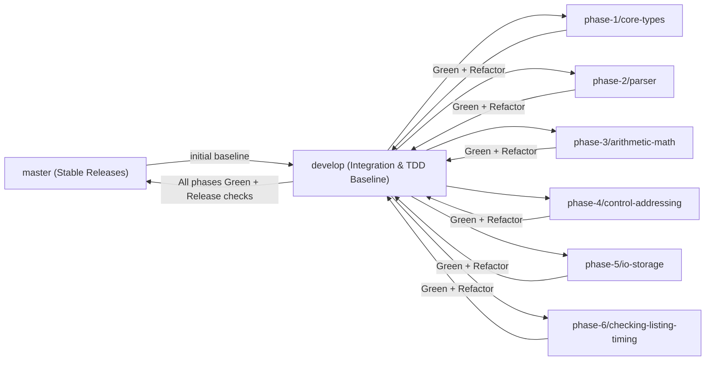
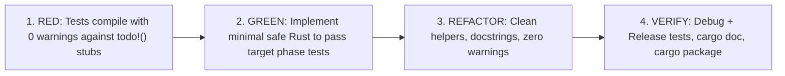

# Development Timeline & Branching Strategy

`speedcoding` follows a Gitflow + milestone-branch model combined with strict **Red -> Green -> Refactor** Test-Driven Development (TDD) on <https://github.com/Mr-Kumar-Abhishek/speedcoding>.

---

## Branch Topology

| Branch | Role | Current Status |
|---|---|---|
| `master` | Stable baseline and verified release tags | Pre-stub crate + licensing setup (`d03f111`) |
| `develop` | Primary integration branch hosting shared API stubs and all phase test suites | Red-phase TDD baseline (66 tests compiling, `todo!()` stubs) |
| `phase-1/core-types` | Phase 1 implementation branch | Synced to `develop` Red-phase baseline |
| `phase-2/parser` | Phase 2 implementation branch | Synced to `develop` Red-phase baseline |
| `phase-3/arithmetic-math` | Phase 3 implementation branch | Synced to `develop` Red-phase baseline |
| `phase-4/control-addressing` | Phase 4 implementation branch | Synced to `develop` Red-phase baseline |
| `phase-5/io-storage` | Phase 5 implementation branch | Synced to `develop` Red-phase baseline |
| `phase-6/checking-listing-timing` | Phase 6 implementation branch | Synced to `develop` Red-phase baseline |

---

## Phase Timeline & Scope

| Phase | Branch | Implementation Module | Test Suite | Tests | SpeedCo I Manual Sections |
|---|---|---|---|---:|---|
| **Phase 1** | `phase-1/core-types` | [`src/core_types.rs`](../src/core_types.rs) | [`tests/phase_1_core_types.rs`](../tests/phase_1_core_types.rs) | 11 | Sec. 1–2 (Storage), Sec. 3-2 (Number Word), Sec. 4-4 (Instruction Layout), Sec. 5 (All 49 `OP1` + 48 `OP2` codes) |
| **Phase 2** | `phase-2/parser` | [`src/parser.rs`](../src/parser.rs) | [`tests/phase_2_parser.rs`](../tests/phase_2_parser.rs) | 10 | Sec. 4-2..4-3, Sec. 7-1..7-4 (Instruction & Data Cards), Sec. 7-17 (Loading Control Cards), Skip-`OP1` constraints |
| **Phase 3** | `phase-3/arithmetic-math` | [`src/arithmetic.rs`](../src/arithmetic.rs) | [`tests/phase_3_arithmetic_math.rs`](../tests/phase_3_arithmetic_math.rs) | 10 | Sec. 3-1..3-4 (Add/Sub/Mpy/Div), Sec. 6, Appendices 1–2 (Set 1 `SQRT`, `SINE`, `ARTAN`, `EXP`, `LN`) |
| **Phase 4** | `phase-4/control-addressing` | [`src/control.rs`](../src/control.rs) | [`tests/phase_4_control_addressing.rs`](../tests/phase_4_control_addressing.rs) | 12 | Sec. 4-1 (`PC = 300`), Sec. 8 (Transfers & Sense Switches), Sec. 9 (`R`-quantities, Address Counter, `0025`, Worked Examples) |
| **Phase 5** | `phase-5/io-storage` | [`src/io.rs`](../src/io.rs) + `load_deck` | [`tests/phase_5_io_storage.rs`](../tests/phase_5_io_storage.rs) | 11 | Sec. 7-4..7-19 (7-ch Tape Parity, Status Matrix, `RFTP`/`RBTP`/`SFTP`/`SBTP`, Drums `P`/`Q`, Line Printer, Card Reader) |
| **Phase 6** | `phase-6/checking-listing-timing` | [`src/diagnostics.rs`](../src/diagnostics.rs) | [`tests/phase_6_checking_listing_timing.rs`](../tests/phase_6_checking_listing_timing.rs) | 11 | Sec. 10 (`PRCH`/`STCH`/`ECHTR`), Sec. 11 (Selective Listing & 10-line Drum Buffer), Sec. 12 & Appendices (Execution/Tape/Load Timing) |

*(Plus `mpc_library_inclusion` in [`src/lib.rs`](../src/lib.rs), verifying `mpc-rs` crate integration — **66 tests total**.)*

---

## TDD Workflow & Definition of Done

A `phase-N/*` branch is ready to merge into `develop` only when:
1. All `tests/phase_N_*.rs` tests (and all prior phase tests + `src/lib.rs` unit tests) compile and pass in both debug (`cargo test`) and release (`cargo test --release`) profiles with **0 warnings**.
2. Public items carry concise rustdoc comments and `cargo doc --no-deps` builds cleanly.
3. `cargo package --list --allow-dirty` completes with 0 warnings and keeps `102632810-05-01-acc.pdf` excluded.
4. Changes on `phase-N/*` are merged back into `develop` and synced forward to dependent phase branches before promoting `develop` to `master`.
