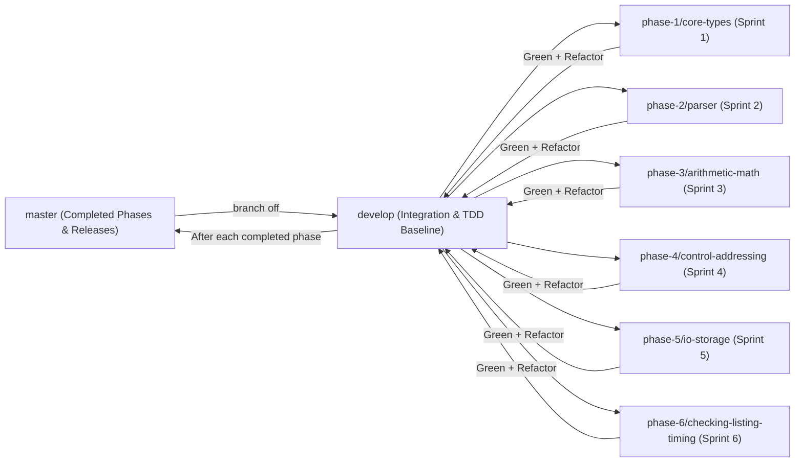
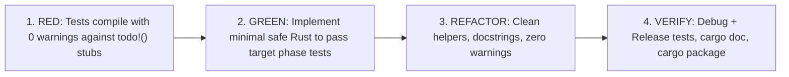

# Development Timeline & Branching Strategy

`speedcoding` follows a Gitflow + milestone-branch model aligned with 2-week **Agile Sprints** and **Red -> Green -> Refactor** Test-Driven Development (TDD) on <https://github.com/Mr-Kumar-Abhishek/speedcoding>. Once each phase/sprint turns Green and passes CI on `develop`, `develop` is merged directly into `master`. For Sprint ceremonies, Fibonacci estimates, and the full `US-01..US-14` backlog, see [AGILE-SPRINTS.md](AGILE-SPRINTS.md).

---

## Branch Topology

| Branch | Role | Current Status |
|---|---|---|
| `master` | Completed phases and verified releases; updated from `develop` after each phase passes CI | **Done** — Synced for `v0.1.0` (`79/79` passing Debug & Release, CI Run `#44987613774` + Docker + Release CD) |
| `develop` | Primary integration branch hosting shared API stubs, CLI, docs, CI/CD, Docker, benchmarks, and all test suites | **Done** — Sprint 7 integrated (`79/79` passing; `0` remaining stubs) |
| `phase-1/core-types` | Sprint 1 implementation branch | **Done** — synced with `v0.1.0` (`src/core_types.rs`, `11/11` passing in Debug & Release) |
| `phase-2/parser` | Sprint 2 implementation branch | **Done** — synced with `v0.1.0` (`src/parser.rs`, `10/10` passing in Debug & Release) |
| `phase-3/arithmetic-math` | Sprint 3 implementation branch | **Done** — synced with `v0.1.0` (`src/arithmetic.rs`, `10/10` passing in Debug & Release) |
| `phase-4/control-addressing` | Sprint 4 implementation branch | **Done** — synced with `v0.1.0` (`src/control.rs`, `12/12` passing in Debug & Release) |
| `phase-5/io-storage` | Sprint 5 implementation branch | **Done** — synced with `v0.1.0` (`src/io.rs`, `11/11` passing in Debug & Release) |
| `phase-6/checking-listing-timing` | Sprint 6 implementation branch | **Done** — synced with `v0.1.0` (`src/diagnostics.rs`, `11/11` passing in Debug & Release) |

---

## Sprint & Phase Timeline

| Sprint | Phase / Branch | Target Tag | Implementation Module | Test Suite | Tests | SpeedCo I Manual Sections |
|---|---|---|---|---|---:|---|
| **Sprint 0** | Bootstrap (`develop` -> `master`) | `v0.1.0-alpha.1` *(Done)* | [`src/lib.rs`](../src/lib.rs), [`src/main.rs`](../src/main.rs), `docs/`, `report/`, `.github/` | `mpc_library_inclusion`, `bench_speedcoding`, 6 phase skeletons | 1 + 5 + 65 | Repository setup, licensing, `mpc-rs`, docs, Pages, benchmarks, CI, pre-release |
| **Sprint 1** | Phase 1 (`phase-1/core-types` -> `develop` -> `master`) | `v0.1.0-alpha.2` *(Done)* | [`src/core_types.rs`](../src/core_types.rs) | [`tests/phase_1_core_types.rs`](../tests/phase_1_core_types.rs) | 11 *(11/11 Green)* | Sec. 1–2 (Storage), Sec. 3-2 (Number Word), Sec. 4-4 (Instruction Layout), Sec. 5 (All 49 `OP1` + 48 `OP2` codes) |
| **Sprint 2** | Phase 2 (`phase-2/parser` -> `develop` -> `master`) | `v0.1.0-alpha.3` *(Done)* | [`src/parser.rs`](../src/parser.rs) | [`tests/phase_2_parser.rs`](../tests/phase_2_parser.rs) | 10 *(10/10 Green)* | Sec. 4-2..4-3, Sec. 7-1..7-4 (Instruction & Data Cards), Sec. 7-17 (Loading Control Cards), Skip-`OP1` constraints |
| **Sprint 3** | Phase 3 (`phase-3/arithmetic-math` -> `develop` -> `master`) | `v0.1.0-alpha.4` *(Done)* | [`src/arithmetic.rs`](../src/arithmetic.rs) | [`tests/phase_3_arithmetic_math.rs`](../tests/phase_3_arithmetic_math.rs) | 10 *(10/10 Green)* | Sec. 3-1..3-4 (Add/Sub/Mpy/Div), Sec. 6, Appendices 1–2 (Set 1 `SQRT`, `SINE`, `ARTAN`, `EXP`, `LN`) |
| **Sprint 4** | Phase 4 (`phase-4/control-addressing` -> `develop` -> `master`) | `v0.1.0-alpha.5` *(Done)* | [`src/control.rs`](../src/control.rs) | [`tests/phase_4_control_addressing.rs`](../tests/phase_4_control_addressing.rs) | 12 *(12/12 Green)* | Sec. 4-1 (`PC = 300`), Sec. 8 (Transfers & Sense Switches), Sec. 9 (`R`-quantities, Address Counter, `0025`, Worked Examples) |
| **Sprint 5** | Phase 5 (`phase-5/io-storage` -> `develop` -> `master`) | `v0.1.0-alpha.6` *(Done)* | [`src/io.rs`](../src/io.rs) + [`src/control.rs`](../src/control.rs) (`load_deck` & I/O `OP1`) | [`tests/phase_5_io_storage.rs`](../tests/phase_5_io_storage.rs) | 11 *(11/11 Green)* | Sec. 7-4..7-19 (7-ch Tape Parity, Status Matrix, `RFTP`/`RBTP`/`SFTP`/`SBTP`, Drums `P`/`Q`, Line Printer, Card Reader) |
| **Sprint 6** | Phase 6 (`phase-6/checking-listing-timing` -> `develop` -> `master`) | `v0.1.0-beta.1` *(Done)* | [`src/diagnostics.rs`](../src/diagnostics.rs) + [`src/control.rs`](../src/control.rs) (checking & listing) | [`tests/phase_6_checking_listing_timing.rs`](../tests/phase_6_checking_listing_timing.rs) | 11 *(11/11 Green)* | Sec. 10 (`PRCH`/`STCH`/`ECHTR`), Sec. 11 (Selective Listing & 10-line Drum Buffer), Sec. 12 & Appendices (Execution/Tape/Load Timing) |
| **Sprint 7** | Release (`develop` -> all 8 branches -> `master`) | `v0.1.0` *(Done)* | [`src/main.rs`](../src/main.rs), [`tests/e2e_speedcoding.rs`](../tests/e2e_speedcoding.rs), `Dockerfile`, `compose.yaml`, [`.github/workflows/release.yml`](../.github/workflows/release.yml) | [`src/main.rs`](../src/main.rs) (`4`), [`tests/e2e_speedcoding.rs`](../tests/e2e_speedcoding.rs) (`4`) + all prior targets | **79** *(79/79 Green)* | Sec. 9-6 matrix multiplication, punched-card checking & printer, tape/drum roundtrip, timing/listing E2E, Docker + automated CI/CD release |

---

## TDD Workflow & Definition of Done

A `phase-N/*` Sprint branch is ready to merge into `develop` (and subsequently `master`) only when:
1. All `tests/phase_N_*.rs` tests (and all prior phase tests + `src/lib.rs` unit tests) compile and pass in both debug (`cargo test`) and release (`cargo test --release`) profiles with **0 warnings**.
2. Public items carry concise rustdoc comments and `cargo doc --no-deps` builds cleanly.
3. `cargo package --list --allow-dirty` completes with 0 warnings and keeps `102632810-05-01-acc.pdf` excluded.
4. Pull Request checks pass in [`.github/workflows/rust.yml`](../.github/workflows/rust.yml), all 8 branches (`master`, `develop`, `phase-1..6`) are fast-forward synced & verified green across CI/Pages **before** tagging, and `v*` release tags trigger [`.github/workflows/release.yml`](../.github/workflows/release.yml).
